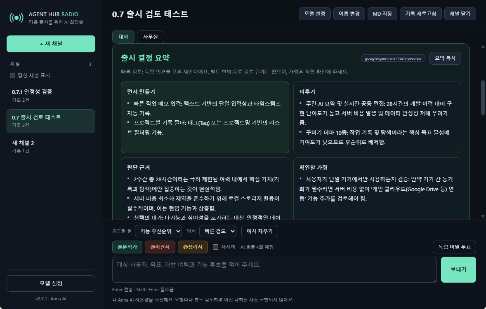

# Agent Hub Radio on Anna

[한국어 안내](README.md) · [Data use](DATA_USE.md)

**An AI meeting room for deciding what to build next.** Share your audience, release goal, available time and feature ideas. An analyst, critic and editor help organise what to build first, what to defer, the reasons, assumptions and one next action.

Currently an owner test draft, **0.8.0**. It has not been released publicly; the first planned review version is 1.0.0. Unlike the [local CLI product](../README.md), this Anna app needs no separate CLI, API key or developer-hosted server.

## Try your first review

1. Open the installed app in Anna. **English is the default for new users.** To change it, open **Model settings → Language**, choose a language, then close the dialog.
2. Select **+ New channel**, then **Use example**. This fills the input without making an AI call.
3. Adapt the audience, goal, capacity and feature candidates. Each request is separate; earlier channel conversations are not included automatically.
4. Keep **Feature priorities**, **Quick review** and all three roles selected. Check the four-call estimate and select **Send**.
5. Read the **Release decision brief**. Expand **Read all role opinions and progress** for the individual responses, or use **Copy brief**.

Quick review collects opinions and a synthesis. **In-depth debate** adds rebuttals and reviews after the final proposal. Remaining disagreements appear with the result. If the model does not follow the requested five-section format, the full response is still shown.

## Choose your language

The UI and new AI requests support **English, Korean, Simplified Chinese and Japanese**. The choices appear as **English / 한국어 / 简体中文 / 日本語**. Changing the language saves your choice, updates labels, examples and dates, and makes no AI call. Existing saved choices are preserved rather than replaced by the new English default.

Your input draft and saved text are kept as written. Existing runs resume in the language they started in, even if you later change the UI language. Switching languages does not translate earlier responses. The screenshots in this guide were captured from the earlier 0.7.1 Korean UI; four-language support begins with 0.8.0.

## Compare options and keep the result

Choose **Secret ballot**, enter the decision context and 2–6 options, and select the participants. Choices stay hidden until all participating roles have been processed. The result separates votes, abstentions and any failed/skipped roles, and includes reasons and concerns.

Use channels for different topics. **Save MD** exports all records in the selected channel, including records beyond the latest 30 shown on screen. Individual runs can be copied or deleted. Closing a channel keeps its records; it is not deletion.

The **Office** tab shows role status. Selecting a role opens its details; **Open in chat** returns to the full record. Viewing the office does not make an AI call.

## AI allowance and models

| Mode | With three roles |
|---|---:|
| Quick review | 4 AI calls |
| In-depth debate | 9 AI calls |
| Secret ballot | 3 AI calls |

Generation uses your Anna account's AI allowance. These counts are not token counts or prices. Retrying an unfinished step can use additional allowance. Opening records, changing settings, copying/exporting and retrying a save alone do not call AI.

In **Model settings**, **Family → Automatic** and **Models used before → No preference** let Anna choose an available model. Preferences do not guarantee a particular model; each reply displays the model actually used. All three roles may use the same model. They are AI perspectives, and agreement or a majority vote does not verify facts. The app does not execute code or modify your files.

## When a run stops

- **Saving failed:** keep the window open, copy any unsaved response, then use **Retry saving only**. This does not generate it again. Resume remaining steps separately after saving succeeds.
- **Model/allowance error:** check your Anna allowance and enabled models. Adjust a restrictive preference if necessary and choose whether to retry.
- **Stopped or timed out:** completed, saved steps are kept. A request already sent may still finish on the server; cancellation and exactly-once billing are not guaranteed.
- **Another window is running:** stop it there, or wait up to 2 minutes 30 seconds after disconnection and refresh records. It will not restart automatically.
- **Conflicting changes:** copy the response you need before loading the latest saved record.

The supported target is Anna's desktop environment. A responsive layout does not establish Android/iOS host availability.

See [data use and deletion](DATA_USE.md), [reviewer walkthrough](store/REVIEW_NOTES.md) and [GitHub Issues](https://github.com/kdkrkwhr/agent-hub/issues). Describe errors and reproduction steps without posting sensitive prompts or responses publicly.
